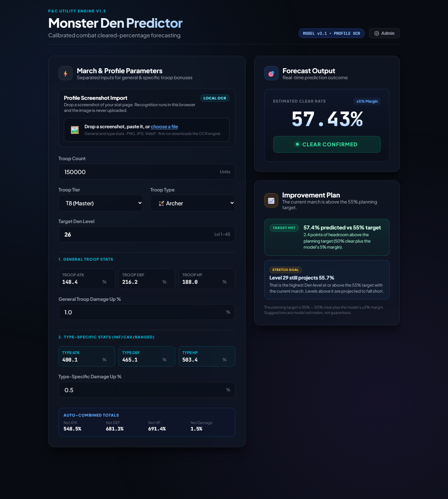

# Monster Den Predictor — Puzzles & Chaos

A simple browser tool that estimates how much of a solo Monster Den you will clear in **Puzzles & Chaos**, and shows what to improve when the result is not good enough.



## What it does

- Forecasts your Monster Den clear percentage from your march and stats.
- Imports your profile stats from a screenshot, locally, with a review step.
- Suggests practical improvements when you are below a safe 55% target.
- Can be calibrated with your own battle results over time.
- Runs entirely in the browser. No install, account, or server.

## How it works

Enter your troop count, tier, type, Den level, and stat bonuses — or drop a screenshot of your stat page and confirm the detected values. The tool compares your march strength against the selected Den's power and estimates the percentage you would clear. Results of 50% or more count as a clear; the improvement plan aims for 55% to leave a margin for error. Profile screenshots are processed in your browser and never uploaded.

## Usage

1. Open `index.html` in a modern browser.
2. Enter your march details and stats, or import a screenshot.
3. Check the forecast and the improvement plan below it.
4. Optional: open **Admin** (PIN `7777`) to log real battle results and improve calibration.

To serve it locally instead:

```bash
python -m http.server 8000
```

Then open <http://localhost:8000>. The folder can also be published as a static site on GitHub Pages.

## Publishing a new calibration

Battle logs stay in your browser. To share an improved model:

1. Open **Admin** (PIN `7777`) and log a few real battle results.
2. Click **Download calibration.js** in the Shared Calibration panel.
3. Replace `calibration.js` in this folder with the downloaded file.
4. Commit and push. GitHub Pages serves the new calibration to every visitor.

The file stores the average coefficient and the number of battles used. Visitors with their own logs keep using their local average; everyone else gets the published value. **Backup logs** downloads a JSON copy of the logs in this browser. If an old value still appears after publishing, wait for the GitHub Pages cache or hard-refresh the page.

## Notes

- The first screenshot import downloads the OCR engine, so it needs an internet connection. Later imports use the browser cache.
- Predictions are estimates, not guarantees.
- This is an unofficial fan project, not affiliated with the game's developers or publishers.
