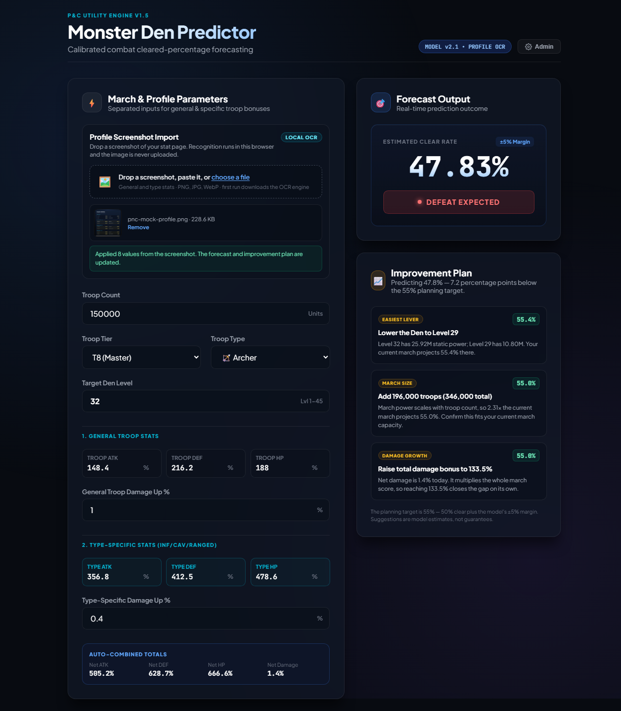
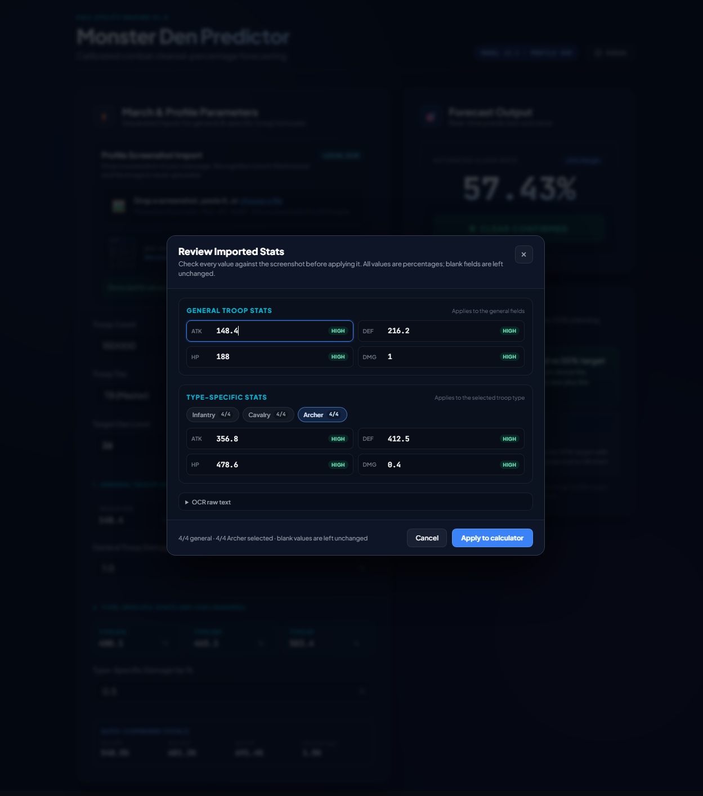
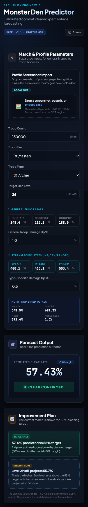

# Monster Den Predictor — Puzzles & Chaos

> A browser-only calculator that forecasts your solo Monster Den clear rate in **Puzzles & Chaos**, reads your stat screen from a screenshot, and tells you which changes will close the gap when the forecast falls short.

No backend, no account, no build step. Open the page, enter your march details (or import a screenshot), and get a live prediction plus a ranked improvement plan. Profile screenshots are processed entirely in your browser — they are never uploaded.

---

## Table of contents

- [Overview](#overview)
- [Features](#features)
- [Screenshots](#screenshots)
- [Quick start](#quick-start)
- [How to use](#how-to-use)
- [The prediction model](#the-prediction-model)
- [How the improvement plan works](#how-the-improvement-plan-works)
- [Screenshot import and OCR](#screenshot-import-and-ocr)
- [Privacy and local data](#privacy-and-local-data)
- [Project structure](#project-structure)
- [Browser support and accessibility](#browser-support-and-accessibility)
- [Tips](#tips)
- [Limitations](#limitations)
- [Version history](#version-history)
- [Credits](#credits)
- [License](#license)

---

## Overview

**Monster Den Predictor** is a fan-made companion tool for the mobile game *Puzzles & Chaos*. It estimates how much damage a solo march will deal in a Monster Den battle by combining:

- troop count,
- troop tier,
- troop type,
- general ATK / DEF / HP / Damage bonuses,
- type-specific ATK / DEF / HP / Damage bonuses,
- the static power of the target Den level,
- and an optional calibration coefficient learned from your own logged battle results.

The result is a predicted kill percentage. A result of **50% or more** is treated as a confirmed clear. A separate **55% planning target** (50% clear plus the model's ±5% margin) drives the improvement plan, so recommendations aim for a comfortable margin rather than a coin flip.

The current version, **v1.5**, adds local screenshot import via OCR and an improvement plan that appears directly below the forecast. The previous stable version, **v1.4**, is kept unchanged in its own folder.

---

## Features

- **Live clear-rate forecast** — every input recalculates immediately.
- **Split stat model** — general troop bonuses and type-specific bonuses are entered separately and summed automatically.
- **All Den levels 1–45** — static Den power is built in.
- **Tier and type modifiers** — T5 through T11 and Infantry / Cavalry / Archer.
- **Battle-log calibration** — log observed kill percentages and the model adjusts its coefficient.
- **Local screenshot OCR** — drop, paste, or choose a screenshot of your stat page. Recognition runs in a Web Worker with Tesseract.js; the image stays on your machine.
- **OCR review dialog** — every detected value is shown with a confidence badge before anything is applied. Values can be corrected, blanked, or skipped.
- **Per-type OCR tabs** — import general stats plus Infantry, Cavalry, and Archer stats from one screenshot, then choose which type to apply.
- **Improvement plan** — ranked, quantified suggestions for Den level, troop tier, march size, stats, damage, and alternative troop types.
- **Pass-state guidance** — shows headroom above the planning target and the highest Den level you could push to.
- **Dark, responsive UI** — works from 320 px phones to wide desktops, with no horizontal overflow.
- **Accessible feedback** — live regions for the forecast and import status, labelled dialogs, keyboard-operable dropzone, and visible focus states.
- **Zero dependencies at runtime** (other than CDN-loaded fonts and the optional OCR engine). No npm install, no bundler.

---

## Screenshots

| Forecast — pass state | Improvement plan — fail state |
| --- | --- |
|  |  |

| Screenshot review dialog | Mobile layout |
| --- | --- |
|  |  |

---

## Quick start

There is nothing to install. The site is plain HTML, CSS, and JavaScript.

### Option 1 — open the file directly

Double-click `index.html` (or drag it into a modern browser).

> Chromium-based browsers (tested in Chrome) work from `file://`, including the OCR worker. Some browsers restrict Web Workers or WebAssembly on `file://`; if the screenshot import does not start, use Option 2.

### Option 2 — run a tiny static server

From the folder that contains `index.html`:

```bash
# Python 3
python -m http.server 8000
```

Then open <http://localhost:8000>.

Any static server works, for example:

```bash
npx serve .
```

### Option 3 — publish with GitHub Pages

1. Push the contents of this folder to a GitHub repository (root, `/docs`, or any folder you select for Pages).
2. In the repository, open **Settings → Pages**.
3. Choose **Deploy from a branch**, select your branch and the folder that contains `index.html`.
4. Save. GitHub serves the site at `https://<user>.github.io/<repo>/` (plus the folder path, if applicable).

No build workflow or environment variables are required.

### Suggested GitHub repository description

> A browser-only Monster Den clear-rate predictor for Puzzles & Chaos, with a calibrated combat model, local screenshot OCR, and ranked improvement suggestions.

Suggested topics: `puzzles-and-chaos`, `monster-den`, `predictor`, `calculator`, `tesseract-js`, `ocr`, `vanilla-javascript`, `github-pages`, `game-tools`, `local-first`.

---

## How to use

### 1. Enter your march details

- **Troop Count** — number of troops in the march.
- **Troop Tier** — T5 through T11.
- **Troop Type** — Infantry, Cavalry, or Archer. This selects which type-specific bonus set is used.
- **Target Den Level** — 1 through 45.

### 2. Enter your stats

Stats are split into two groups:

- **General Troop Stats** — ATK, DEF, HP, and Damage Up that apply to all troops.
- **Type-Specific Stats** — ATK, DEF, HP, and Damage Up for the selected troop type.

The **Auto-Combined Totals** bar shows the sums used by the model:

```text
Net ATK = general ATK + type ATK
Net DEF = general DEF + type DEF
Net HP  = general HP  + type HP
Net DMG = general DMG + type DMG
```

The forecast updates as you type.

### 3. Read the forecast

- **Predicted clear rate** — the model's estimated kill percentage, capped at 0–100%.
- **CLEAR CONFIRMED** — prediction is at least 50%.
- **DEFEAT EXPECTED** — prediction is below 50%.
- **±5% Margin** — the model is empirical, so the UI presents a margin rather than a guarantee.

### 4. Import a profile screenshot (optional)

1. Drop an image onto the dropzone, paste it from the clipboard, or click to choose a file.
2. Supported formats: PNG, JPG/JPEG, WebP, BMP, GIF. Maximum size: 15 MB.
3. The browser preprocesses the image and runs OCR locally.
4. A **Review Imported Stats** dialog opens with the detected values.
5. Check each value, fix anything the OCR misread, choose the type tab you want to apply, then click **Apply to calculator**.

Only the general stats and the currently selected type tab are applied. Blank fields are left unchanged. The troop type is switched automatically when type-specific values are applied.

### 5. Use the improvement plan

When the prediction is below the 55% planning target, the plan lists practical changes ranked by priority. Each card shows the projected clear rate after that single change.

When the prediction is already above 55%, the plan shows:

- how much headroom you have,
- the highest Den level that still meets the 55% target with the current march (stretch goal).

### 6. Calibrate with real battles (optional)

1. Click **Admin** in the header.
2. Enter the PIN `7777`.
3. The diagnostics panel shows march power, static Den power, and the power ratio.
4. After a battle, enter the observed kill percentage and click **Log Battle**.
   - Values below `1` are treated as fractions: `0.5` means 50%.
   - Valid values are above 0 and up to 100.
5. The model recalculates its coefficient immediately. **Reset Model** clears all logs.

> The PIN is a client-side convenience gate, not a security boundary. Do not rely on it to protect sensitive data.

---

## The prediction model

### Inputs and formulas

```text
statSum   = net ATK + net DEF + net HP

marchPower = (troopCount / 100,000)
           × tierModifier
           × typeModifier
           × √(statSum / 100)
           × (1 + netDmg / 100)

enemyPower = denPowerTable[denLevel] / 1,000,000

powerRatio = marchPower / enemyPower

predictedKill = clamp(cAvg × powerRatio^0.1676, 0, 100)
```

- The exponent is **0.1676**.
- The default coefficient is **`cAvg = 59.8861`**.
- With the page's default inputs (150,000 T8 Archers, Den 26, the bundled stat values), the forecast is **57.43%**.

### Tier modifiers

| Tier | Modifier |
| --- | --- |
| T5 | 0.75 |
| T6 | 0.85 |
| T7 | 0.95 |
| T8 | 1.00 |
| T9 | 1.15 |
| T10 | 1.30 |
| T11 | 1.45 |

### Type modifiers

| Type | Modifier |
| --- | --- |
| Infantry | 1.00 |
| Cavalry | 1.10 |
| Archer | 1.05 |
| Mixed Squad | 0.95 |

`Mixed Squad` exists in the engine constants but is not exposed in the current UI.

### Den power table

The raw static power values are listed below. Effective enemy power = raw value ÷ 1,000,000.

<details>
<summary>Show all 45 Den levels</summary>

| Level | Raw power | Level | Raw power | Level | Raw power |
| ---: | ---: | ---: | ---: | ---: | ---: |
| 1 | 50,000 | 16 | 3,600,000 | 31 | 17,424,000 |
| 2 | 120,000 | 17 | 4,100,000 | 32 | 25,920,000 |
| 3 | 200,000 | 18 | 4,600,000 | 33 | 28,080,000 |
| 4 | 300,000 | 19 | 5,100,000 | 34 | 40,320,000 |
| 5 | 450,000 | 20 | 2,700,000 | 35 | 43,200,000 |
| 6 | 600,000 | 21 | 3,600,000 | 36 | 50,400,000 |
| 7 | 800,000 | 22 | 5,280,000 | 37 | 57,600,000 |
| 8 | 1,000,000 | 23 | 5,760,000 | 38 | 64,800,000 |
| 9 | 1,300,000 | 24 | 6,240,000 | 39 | 96,000,000 |
| 10 | 1,600,000 | 25 | 6,720,000 | 40 | 105,600,000 |
| 11 | 1,900,000 | 26 | 9,000,000 | 41 | 115,200,000 |
| 12 | 2,200,000 | 27 | 9,600,000 | 42 | 128,000,000 |
| 13 | 2,500,000 | 28 | 10,200,000 | 43 | 144,000,000 |
| 14 | 2,800,000 | 29 | 10,800,000 | 44 | 160,000,000 |
| 15 | 3,200,000 | 30 | 15,840,000 | 45 | 192,000,000 |

</details>

### Battle-log calibration

Each logged battle stores the observed kill percentage and the power ratio at the time of the log. The coefficient for each log is:

```text
C_i = actualKill / powerRatio^0.1676
```

The displayed coefficient is the simple average of all valid logs:

```text
cAvg = mean(C_i)
```

Entries with a non-finite value, an actual kill outside `(0, 100]`, or a non-positive ratio are ignored. Logs are stored in `localStorage` under `pnc_battle_logs`.

### Thresholds

| Threshold | Meaning |
| --- | --- |
| 50% | Minimum forecast labelled **CLEAR CONFIRMED**. |
| 55% | Planning target used by the improvement plan (50% + 5% margin). |

---

## How the improvement plan works

The required march-power multiplier to reach the target is:

```text
M = (target / predictedKill)^(1 / 0.1676)
```

Because the model is a power law, each lever is converted into practical units:

| Lever | Required change |
| --- | --- |
| **March size** | `troopCount × M` (rounded up to a step of 100 or 1,000) |
| **Stats** | `statSum × M²`, spread evenly as roughly `(requiredSum − statSum) / 3` per stat |
| **Damage** | `100 × (M × (1 + currentDmg / 100) − 1)` percent total damage bonus |
| **Den level** | The highest lower Den level whose projected result meets the target |
| **Tier** | The first higher tier whose modifier alone reaches the target |
| **Type** | An alternative type with a higher modifier, if it alone reaches the target |

To keep the output practical, the plan hides:

- count targets above **2.5×** the current march,
- stat totals above **3×** the current total,
- damage targets above **300%**.

The Den suggestion is prioritised as the easiest lever because it does not require growing the march. Suggestions are independent single-lever estimates — they are not additive, and they are model projections, not guarantees.

---

## Screenshot import and OCR

The import pipeline is fully local:

1. **Load the image** as an `ImageBitmap` (with an `` fallback), capped at 6 million pixels and 15 MB.
2. **Preprocess on a canvas** — scale to roughly 1,400 px wide, then create two variants:
   - a grayscale image with boosted contrast,
   - an Otsu-binarized (black/white) image.
3. **Run Tesseract.js** in a Web Worker:
   - first pass with page segmentation mode `11` (sparse text) on the contrast image,
   - second pass with mode `6` (uniform block) on the binarized image, only when the general stats are incomplete or no complete type group was found.
4. **Parse the text** with `profile-parser.js`:
   - detects sections (`TROOP STATS`, `INFANTRY STATS`, `CAVALRY STATS`, `ARCHER STATS`),
   - matches stat aliases (`ATK`, `DEF`, `HP`, `Damage Up`, and common OCR variants),
   - pairs labels with numbers using bounding boxes first, then a next-line fallback,
   - assigns a confidence level (`high`, `medium`, `low`) based on OCR confidence and pairing quality.
5. **Review before applying** — the dialog shows all detected values. You can:
   - edit any value (the badge changes to **Edited**),
   - leave a field blank to skip it,
   - switch between Infantry / Cavalry / Archer tabs to choose which type-specific set to apply,
   - inspect the raw OCR text under **OCR raw text**.
6. **Apply** — general stats and the selected type's stats are written to the calculator, then the forecast and improvement plan recalculate.

Operational details:

- The OCR engine and English model are loaded from CDNs on first use (a few MB) and cached by the browser afterward. The first import therefore needs an internet connection.
- Each recognition step has a **90-second timeout**; you can cancel an import at any time without changing the calculator.
- If recognition fails, the cached worker is discarded so the next attempt starts cleanly.
- The screenshot is passed to the local worker as a canvas/blob. It is **never uploaded** to a server.

---

## Privacy and local data

- **Screenshots stay local.** OCR runs in your browser. No image data leaves the page.
- **No backend.** There is no API, account system, analytics, or tracking.
- **Network requests** are limited to static assets:
  - Tesseract.js script and worker (jsDelivr),
  - Tesseract WASM core (jsDelivr),
  - English language data (`tessdata.projectnaptha.com`),
  - Google Fonts (Plus Jakarta Sans, JetBrains Mono).
- **Local storage** is used only for battle logs under the key `pnc_battle_logs`.
- Clearing site data in your browser removes the logs. Nothing is synced across devices.

If you need a completely offline installation, download the OCR assets and fonts, host them locally, and update the URLs in `screenshot.js`, the font `<link>` tags in `index.html`, and the OCR configuration.

---

## Project structure

```text
v1.5/
├── index.html          # Page layout: inputs, import panel, forecast, review dialog
├── style.css           # Dark glassmorphism design system and responsive rules
├── engine.js           # Model math, Den power table, battle logs, admin panel
├── profile-parser.js   # Pure OCR text → stat parser (UMD, testable in Node)
├── suggestions.js      # Target analysis and improvement-plan rendering
├── screenshot.js       # Import flow, preprocessing, OCR, review, apply
├── screenshots/        # Images used in this README
└── README.md
```

- `engine.js` exposes `window.PNCEngine` with read-only model constants and fires a `pnc:calculation` event with the full state.
- `suggestions.js` and `screenshot.js` are optional modules that listen for that event; the base calculator works without them.
- `profile-parser.js` has no DOM or network dependencies apart from the optional UMD export.

`v1.4/` contains the previous stable release and is intentionally left unchanged.

---

## Browser support and accessibility

- Modern evergreen browsers with Canvas, Web Workers, WebAssembly, and `<dialog>` support (current Chrome, Edge, Firefox, and Safari).
- Tested primarily in Chromium (headless Chrome) from both `file://` and a local HTTP server.
- Responsive across 320–1440+ px; the layout has been checked for horizontal overflow at common breakpoints.
- Accessibility touches:
  - `aria-live` forecast status,
  - labelled review dialog with `aria-describedby`,
  - keyboard-operable dropzone (`Enter` / `Space`),
  - `aria-pressed` type tabs,
  - visible focus styles and a progress bar with `aria-valuenow`,
  - blank fields explicitly described as "left unchanged".

If OCR fails to start in a particular browser from `file://`, run the page through a local server (see [Quick start](#quick-start)).

---

## Tips

### Better predictions

- Use the **highest tier you will actually field** — tier modifiers are significant.
- Select the troop type whose type-specific bonuses you entered.
- Log several real battles across different Den levels to calibrate the coefficient.
- Treat the 55% planning target as the safe threshold; 50% is a coin flip.

### Better OCR results

- Take a full-resolution screenshot of the stat page, not a compressed chat image.
- Make sure all four general values and at least one complete type group are visible.
- Avoid overlapping UI, tooltips, or animations.
- Prefer the original PNG over a re-encoded JPEG.
- Always review the values — especially any field marked **Low** or **Med**.

---

## Limitations

- This is an **empirical model**, not an official combat simulation. The Den power table and modifiers are built from community observations and may lag behind game updates.
- Predictions carry an inherent ±5% margin; they are not guarantees.
- Calibration averages all valid battle logs equally. A single unusual battle can move the coefficient; larger samples are better.
- OCR accuracy depends on screenshot quality, language, font rendering, and UI layout. The review step is mandatory by design.
- The admin PIN is a client-side convenience gate only.
- There is no cloud sync, user account, or multi-device storage.

---

## Version history

| Version | Highlights |
| --- | --- |
| **v1.5** | Profile screenshot import with local OCR, confidence review dialog, per-type tabs, improvement plan with 55% planning target, right-rail layout, OCR timeouts and worker recovery. |
| **v1.4** | Stable dual-stat calculator with separate general and type-specific bonuses, optimized responsive UI. Kept unchanged as the baseline. |

Model version: **v2.1** (exponent `0.1676`, baseline coefficient `59.8861`).

---

## Credits

- [Tesseract.js](https://github.com/naptha/tesseract.js) for in-browser OCR (Apache-2.0).
- Google Fonts: [Plus Jakarta Sans](https://fonts.google.com/specimen/Plus+Jakarta+Sans) and [JetBrains Mono](https://fonts.google.com/specimen/JetBrains+Mono).
- Game data and calibration values gathered from community testing and observation.

This is an unofficial fan project. It is not affiliated with or endorsed by the developers or publishers of *Puzzles & Chaos*. Game names and related marks belong to their respective owners.

---

## License

No license file has been included yet. If you plan to publish, distribute, or accept contributions to this repository, add a `LICENSE` file (for example, MIT) so the reuse terms are explicit.
